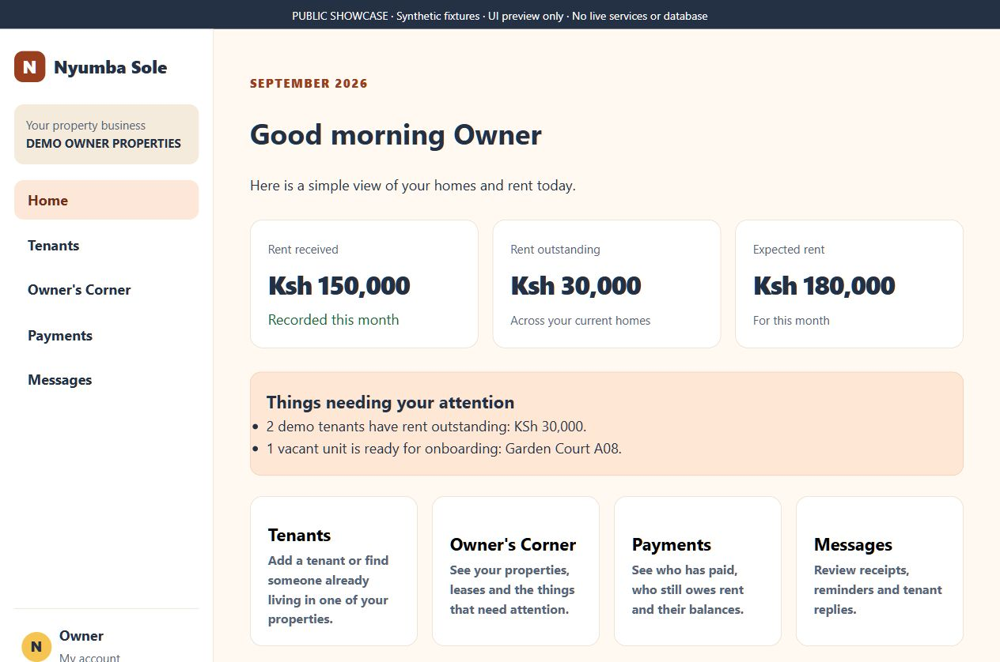
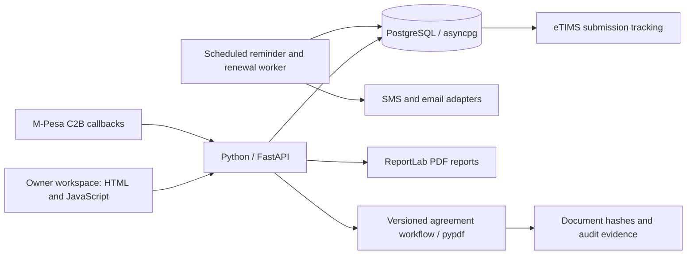

# Nyumba Sole — engineering showcase

**Property management and rent-record workflows for a Kenyan rental portfolio.**

Nyumba Sole addresses a practical internal-tool problem: rent payments, tenant records, agreements and follow-ups spread across spreadsheets and messages are difficult to reconcile and audit. The application brings these workflows into an owner workspace backed by PostgreSQL.

This repository is a **selected public showcase**, not the full application. The complete backend, UI, provider adapters, operational configuration and private records remain outside this repository. It shares enough code to inspect concrete design choices while limiting exposure of the implementation.

The full application is maintained separately in a private repository. This public repository is the portfolio link intended for application reviewers.

Latest milestone check: **13 October 2026** — 35 private application tests passed with none skipped, plus a database-backed browser check of all five Owner’s Corner alert types. [Read the completed weekly milestones](docs/WEEKLY_MILESTONES.md).

## Screenshots and demo tours



Read the [brief case study](docs/CASE_STUDY.md) for the manual problem, implementation decisions and a tested exception.

See the [two-minute recruiter walkthrough](docs/RECRUITER_WALKTHROUGH.md) and [engineering walkthrough](docs/ENGINEERING_WALKTHROUGH.md). Eight screenshots show the sanitized application screens with synthetic fixtures. Each carries a visible preview banner. These are browser captures of a local UI harness, not evidence of a live database, provider delivery or completed signatures. Full UI source and the capture harness remain outside this repository.

## Engineering evidence you can inspect

| Sample | What it demonstrates |
|---|---|
| [Tenant validation](samples/tenancy_validation.py) | Typed onboarding data, exact decimal rent/deposit values and lease-date validation |
| [M-Pesa event model](samples/c2b_event.py) | C2B payment parsing, provider reference aliases and positive received amounts |
| [Allocation migration excerpt](samples/payment_allocations.sql) | Separate payment/invoice allocation records, append-only triggers and numeric accounting |
| [Executable sample tests](tests/test_samples.py) | Accepted/rejected financial terms, date boundaries and provider field variants |

The Python samples were extracted from the project and stripped of application configuration and transport dependencies. Tests use synthetic fixtures. The SQL combines sanitized allocation-schema and follow-up integrity excerpts, dependent on the full application schema; it cannot be applied as a standalone migration.

## Full-project architecture



The full project includes eleven PostgreSQL migrations. Its records separate holdings, properties, units, tenants, leases, rent terms, invoices, received payments, allocations, receipts, communications and agreement evidence. Authentication, roles, property membership and PostgreSQL row-level security define access boundaries; production needs properly separated runtime and migration roles.

## Workflows represented in the project

- **Rent accounting:** shared Paybill unit references, unique transaction identifiers, unmatched-reference review, distinct received money and invoice allocations, receipts and outstanding balances.
- **Tenant lifecycle:** onboarding, rent and refundable deposit, vacancy handling, former tenancies and historical rent terms.
- **Reports:** PDF receipts, tenant statements, M-Pesa history, monthly property reports, annual reports and occupancy history.
- **Signing:** upload a final PDF → create an agreement version → send a time-limited link → verify OTP and consent → tenant signs → authenticated owner countersigns → final PDF certificate and retained document hashes/audit events.
- **Automation:** scheduled rent reminders, renewal prompts and persisted delivery attempts.

These descriptions come from inspecting the full source. They are not claims of production deployment, live provider certification or an end-to-end test of every workflow. There is no AI agent or LLM feature in the inspected code.

## Mocked versus production-dependent

| Area | Local/project implementation | Still requires production work |
|---|---|---|
| PostgreSQL | Migrations, accounting queries, lifecycle history | Broader reconciliation, deployment grants, backup/restore and monitoring |
| M-Pesa | Event parsing, routing, de-duplication, allocation code | Approved Paybill, credentials, secured callbacks, sandbox validation |
| SMS/email | Mock delivery and adapter implementations | Approved senders, credentials, actual delivery reports and consent review |
| Signing | Single versioned route; OTP lockout, consent and finalization tested on PostgreSQL | Provider/identity assurance, browser usability, legal wording and retention |
| KRA/eTIMS | Configurable adapter and submission tracking | Provisioned endpoint/payload validation, applicable tax treatment and provider approval |
| Reports | PDF generators and database queries | Fresh reconciliation and visual output verification |

No adapters or credentials are included here. The full sanitized local copy uses mock mode; publishing this showcase does not expose a working service.

## Run the public samples

Use Python 3.11+ from this repository directory:

```powershell
python -m venv .venv
.\.venv\Scripts\Activate.ps1
python -m pip install -r requirements.txt
python -m pytest -q
```

No database, environment file, cloud account or provider credentials are needed. These tests validate the Python samples only. They do not execute SQL, exercise concurrent payment allocation or verify full reports/signing.

The follow-up allocation excerpt uses exclusive reservation locks and checks payment limits, invoice capacity and unit relationships. These behaviors were exercised by the private application’s disposable PostgreSQL concurrency tests. The public sample suite itself does not execute SQL. See [validation and limits](docs/VALIDATION.md).

## Source protection and privacy

Only selected samples, documentation and sanitized screenshots are public. No full application, Git history, private identity, real tenant data, uploaded document, signature evidence, environment file or credential is included. Original screenshots and reports were excluded; new images were captured from a synthetic local preview.

No open-source license is granted for the original sample code. See [rights notice](NOTICE.md). Public files can still be viewed and forked under GitHub's terms; this notice does not prevent copying technically. Third-party dependencies retain their own licenses.

Prepared for the GitHub profile [Uwaziman1](https://github.com/Uwaziman1). The showcase presents inspected project work and current validation limits without inventing authorship metrics or live integration claims.
