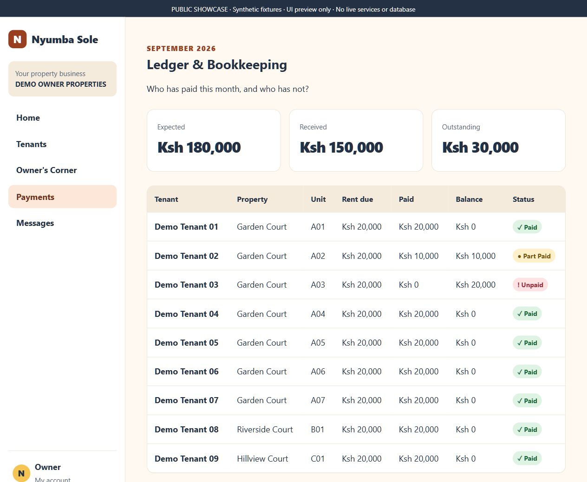
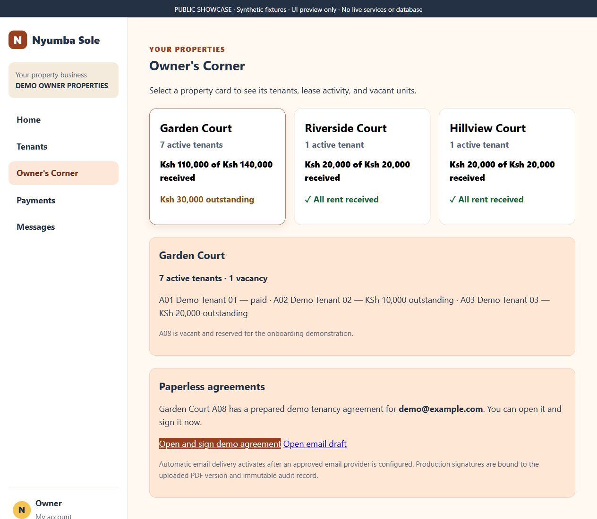
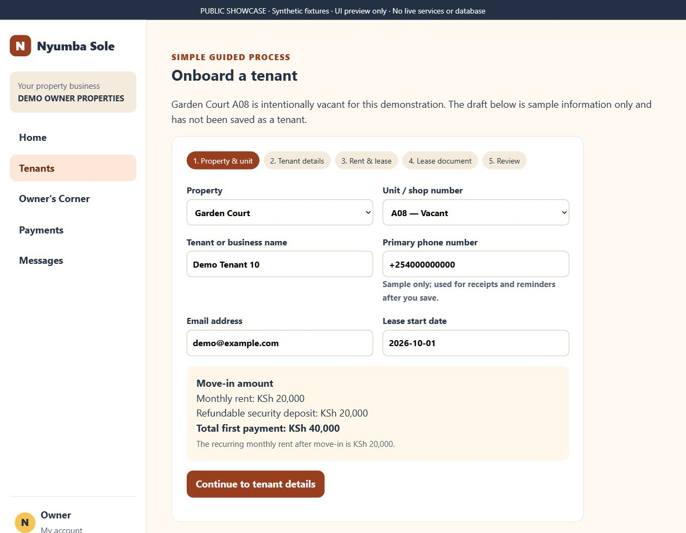
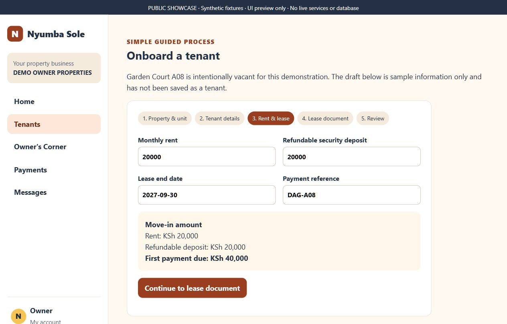
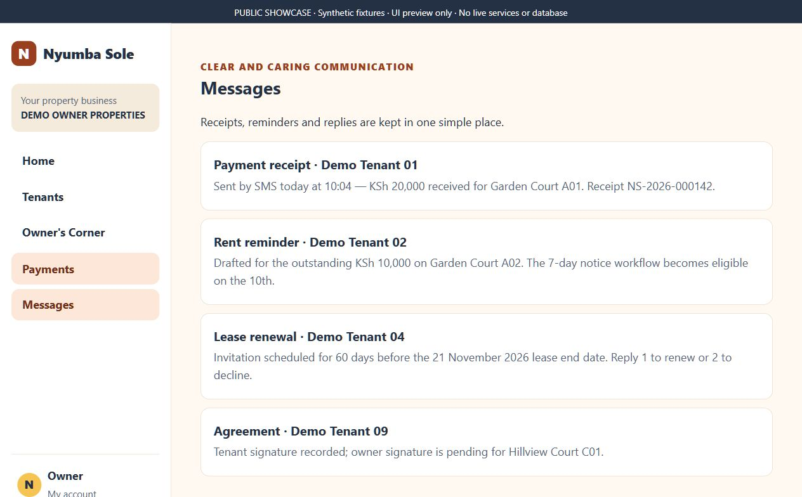
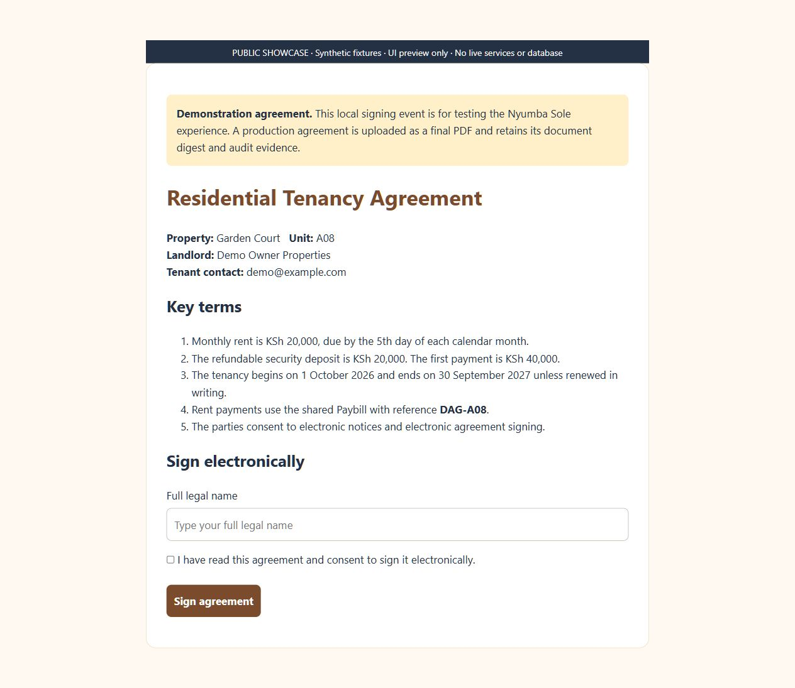
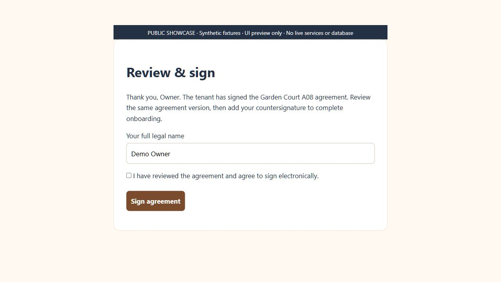

# Two-minute recruiter walkthrough

This tour shows how Nyumba Sole organizes an owner's daily rental administration. All people, contacts, property names and financial scenarios are synthetic. The images are actual browser captures of sanitized source screens rendered through a local UI harness; no database or external services were connected. Delivery and signature messages are fixture text, not evidence of actions performed.

## 1. See what needs attention — 20 seconds

The owner starts with three figures: KSh 150,000 received, KSh 30,000 outstanding and KSh 180,000 expected. The attention panel identifies unpaid rent and a vacant unit. The purpose is to make the next administrative action clear without navigating a spreadsheet.

## 2. Explain the unpaid amount — 25 seconds

Demo Tenant 02 owes KSh 10,000 and Demo Tenant 03 owes KSh 20,000. The other seven tenants have paid KSh 20,000 each. Thus KSh 140,000 + KSh 10,000 = KSh 150,000 received, while KSh 10,000 + KSh 20,000 = KSh 30,000 outstanding. These fixture totals agree with the overview.

## 3. Move from the portfolio to a property — 20 seconds

Garden Court shows seven active tenants, one vacancy and KSh 30,000 outstanding. Two other demo properties are fully paid. Selecting the property exposes its preview summary; the full application's database workspace is outside this public package.

## 4. Guide tenant onboarding — 25 seconds

The wizard separates property/unit selection, tenant details, financial terms, the lease document and review. The vacant A08 unit is reserved for this demonstration. Nothing was saved.

Recurring rent and refundable deposit remain distinct: KSh 20,000 + KSh 20,000 gives a KSh 40,000 first payment. Recurring monthly rent remains KSh 20,000.

## 5. Connect communication and agreements — 30 seconds

The messages screen illustrates receipt, reminder, renewal and agreement status categories. The displayed “sent” and “signature recorded” text is pre-existing demo content; no SMS, email or signing action occurred during capture.

The agreement screens illustrate tenant review/consent and a separate owner countersignature step. Both forms were left unsigned. The persisted workflow's OTP, document hashes and certificate generation are described in the README and require further end-to-end validation.

## Suggested spoken introduction

“Nyumba Sole is a property-management project that brings tenant records, payment reconciliation, reports and agreement workflows into one owner workspace. This public version contains synthetic screenshots and selected code examples. The full project uses Python, FastAPI and PostgreSQL, with integration foundations for M-Pesa, SMS, email and eTIMS. These previews demonstrate the user journey; production integrations and signing validation remain separate work.”
