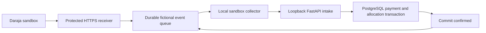

# Stable sandbox callback connection

The owner approved a separate hosted receiver for fictional sandbox events. The
full FastAPI app, PostgreSQL, tenants, signing records and Daraja consumer keys stay
local. A durable D1 transit queue receives minimal payment facts and strips names
and phone numbers. Only QA-prefixed references and its configured sandbox shortcode
are accepted. Separate secrets protect callback submission and queue collection.

## What is verified

Fifteen private hosted HTTPS/D1 checks passed. After the owner approved public
reachability, fifteen further fictional checks passed without platform sign-in.
They exercise authentication, concurrent replay, immutable conflict rejection,
personal field stripping, validation without enqueue, repeated collection before
acknowledgement, and replay after acknowledgement. These are our synthetic events;
they do not establish Safaricom callback delivery.

Registration with the portal test preset was rejected before a payment request.
Registration with the original C2B sandbox shortcode was accepted. This proves
request acceptance only; actual callback reconciliation remains a separate check. A separately identified v2 simulation was later accepted but produced no confirmation during its three-minute check. The current client default matches the signed-in portal's v2 simulation endpoint.
Neither test values, full registered URLs nor provider identifiers belong in source.

## Local collection

The commands below require the private application. The showcase contains no full app implementation.

Keep two configuration files outside source with owner-only permissions: ordinary
sandbox app settings, and relay JSON with `base`, `ingress`, `pull`, `shortcode`.
The JSON contains secrets. Never paste it into chat or commit it. The consumer keys
belong only in the local app settings; the relay never needs them.

`python -m scripts.daraja_sandbox --config PRIVATE_SETTINGS_FILE --relay-config PRIVATE_RELAY_FILE`
performs offline preflight. Add `--register` only for an explicitly intended sandbox
registration. The relay's independent ingress token is used for registered URLs;
the local callback token is not transmitted to the hosted receiver.

Start a fictional local app with a separately verified sandbox database. Then run
`python -m scripts.sandbox_relay --config PRIVATE_SETTINGS_FILE --relay-config PRIVATE_RELAY_FILE --upstream http://127.0.0.1:8000`.
It collects once. Add `--watch` for ongoing collection; Ctrl+C stops it. It refuses
production mode, non-demo records, non-loopback upstreams and insecure relay origins.
It never initiates a payment and needs no consumer credentials in the cloud.

Collection acknowledges each event only after local intake returns its post-commit
success. A local failure leaves the event pending. A crash or lost acknowledgement
after commit causes a replay through the existing immutable callback inbox, avoiding
duplicate money and receipts. Watch mode backs off failed collection up to 60 seconds.

## Limits

Hosted acknowledgement proves queue persistence, not payment allocation. Local
post-commit acknowledgement proves intake, not SMS/email delivery. Those notification
transports remain mocked in fictional verification. Keep platform logs, runtime
configurations and generated evidence private. Rotate callback tokens after testing.
Production Paybill/Till provisioning, provider approval and a production ingress
security review remain separate work; this receiver intentionally rejects real use.

A further independent v2 control used the documented one-shilling amount and a fresh fictional reference. Its registration and simulation were accepted, but no confirmation arrived during three minutes. No second payment was requested. This does not establish a sandbox balance limit or the reason for non-delivery. Payment requests were stopped; the durable receiver remains available.
